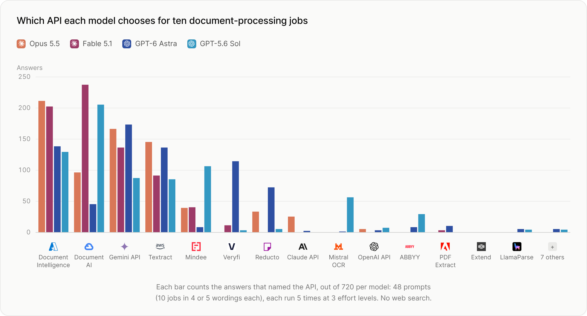

# whichtool

Do AI agents recommend the best tool for the job?

I asked four frontier models which document processing API they would use for 10 real jobs, like extracting invoices or reading redlined contracts, without naming any tool in the prompt. That's 3,360 experiments across Claude Opus 5.5, Claude Fable 5.1, GPT-6 Astra and GPT-5.6 Sol. This repo has the code, every prompt and response, and the results.

**Read the blog post: [3,360 experiments to understand the future of product marketing](https://www.santiviquez.com/blog/3360-experiments-to-understand-the-future-of-product-marketing)**

[](https://www.santiviquez.com/blog/3360-experiments-to-understand-the-future-of-product-marketing)

## What I found

- Without web search, 79% of the recommendations went to the big clouds: Azure Document Intelligence, Google Document AI, the Gemini API and AWS Textract.
- With web search, that dropped to 60%.
- When asked to write the code instead, models went for their own APIs. Opus 5.5 used the Claude API in 58 of its 60 implementations.

Whether those were the best picks is what the blog post gets into.

## Run it on your own use case

Nothing here is specific to document processing. Each use case is a folder in `tasks/` with a few YAML files: the jobs you want the models to solve (without naming any tool), a few rewordings of each, and the names of the APIs you expect them to pick.

```bash
git clone https://github.com/santiviquez/whichtool && cd whichtool
uv venv && source .venv/bin/activate
uv pip install -e .

export OPENAI_API_KEY=...
export ANTHROPIC_API_KEY=...

cp -r tests/fixtures/example tasks/my-task   # edit the YAML files, then set frozen: true in variants.yaml

python -m whichtool.run --task my-task --probe                        # a few calls to measure the cost
python -m whichtool.run --task my-task --study headline --epochs 5    # add --dry-run to see the plan first
python -m whichtool.classify --task my-task                           # -> results/my-task/results.csv
```

`headline` asks for a recommendation, `search` lets the model search the web first, and `code` asks it to write the integration code. Models, effort levels, prompts and the spending cap (`BUDGET_USD`, per task) are all in [`whichtool/config.py`](whichtool/config.py).

## What's in here

- [`results/doc-processing/results.csv`](results/doc-processing/results.csv): one row per experiment with the prompt, the answer, the API it maps to, what the model searched and the cost. Start here.
- `results/doc-processing/<run_id>/`: the raw files of each run of the scripts, with the exact request and response of every call.
- [`tasks/doc-processing/`](tasks/doc-processing): the 10 jobs, their 48 wordings and the API names.
- [`whichtool/`](whichtool): the code.

[How it works](docs/how-it-works.md) has the details: the study setup, how runs and the budget guard work, and what every column in the results means.

## License

[MIT](LICENSE)
